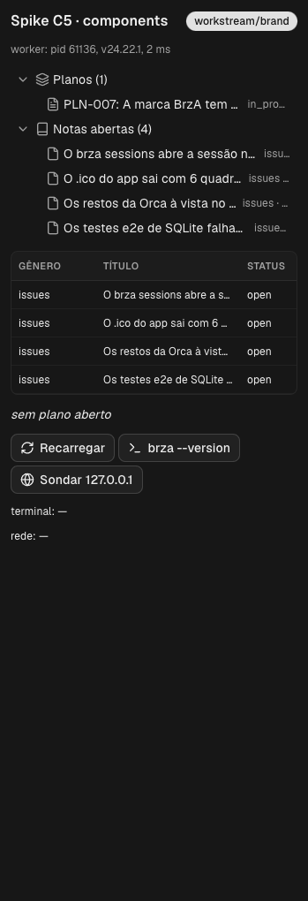
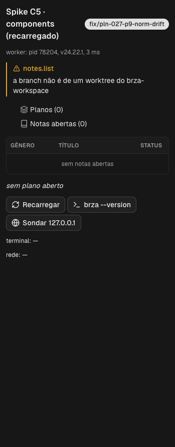
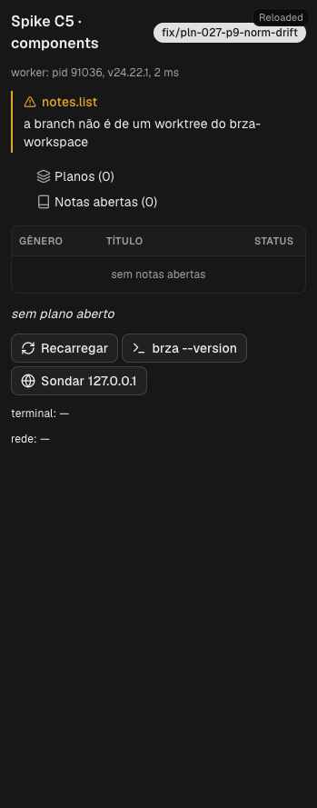

---
scope:
  - workspace
  - brza-studio
refs:
  - PLN-003
  - issue:o-approve-do-plugin-e-barrado-no-modo-auto
  - issue:o-cli-do-orca-no-chat-do-studio-fala-com-o-studio
  - issue:o-dev-watch-deixa-carregado-o-plugin-que-ja-estava
  - issue:os-tipos-de-plugin-faltam-no-pacote-da-1-4-246
---

# O PLN-003: o spike do C5 nos dois apps

Continuação de [O PLN-003: o spike do C5 parou na aprovação](2026-11-03-pln-003-o-spike-do-c5-parou-na-aprovacao.md).
A pergunta "aprovar o `trusted-worker` do spike?" foi respondida por Anderson nesta sessão, em 2026-11-03: **"Aprovar
nos dois apps"**, a opção 1 (recomendada). Com isso, o spike rodou até o fim, no BrzA Studio `1.4.246-alpha.1` e no
Orca `1.4.247`.

## O que rodou e o que deu

O plugin é o de `spikes/c5-plugin/`, sem mudança de código além de um título editado e desfeito para o item 5.
- **Aprovação:** o `dev load` imprimiu o mesmo fingerprint de antes, `ap1-aedbb65284d0297120a721e7e67266a2`, com as
  mesmas capacidades, e o `--approve` passou nos dois apps (`"approval": "approve-flag"`).
- **Studio:**
  - `ping` → pid 61136, Node 24.22.1, 0,19 s.
  - `notes.list` → `workstream/brand`, com 1 plano e 4 issues; depois `workstream/tools-kit`, com 2 planos e 10 notas.
  - Os shots dos dois painéis saíram `settled: true`. O html registrou o bloqueio da CSP para `127.0.0.1`.
  - O foco no `brand` não tinha terminal. A sessão abriu o shell `c5-spike` (`brza terminal create --worktree active`),
    e o worker digitou `brza --version` nele (`accepted: true`, saída `1.4.246-alpha.1`).
  - Depois, alguém apertou o botão do painel, provavelmente Anderson, e o worker digitou o mesmo comando no "Terminal
    1" do `tools-kit`. Só esse comando rodou ali.
  - `net.probe` → 200 em 17 ms.
  - `dev reload` → `already-approved`.
  - Shot com a janela escondida → `settled: true`.
- **Orca:**
  - `ping` → pid 78204.
  - `notes.list` → "a branch não é de um worktree do brza-workspace", porque o Orca só tem os repositórios da Fixfy.
  - Os shots, depois do `orca file open README.md --focus` num worktree da Fixfy, saíram `settled: true`.
  - O worker digitou no shell `c5-spike`, aberto por `orca terminal create` no worktree em foco. O `brza` desse
    terminal é o CLI do Studio.
  - `net.probe` → 200 em 15 ms.
  - Shot com a janela escondida → `settled: true`.
  - `dev watch --check --shot` → `reloaded`, `check`, `shot` ao salvar, e o painel com o selo "Reloaded".
- **`audit.log` dos dois:** `plugins.approve` como `cli:local`, e `terminal.sendText` com `bytes=14`, sem o texto.

O resultado por item está no C5 do
[Desenho](../../plans/PLN-003-o-workflow-nos-dois-clients/PLN-003-design.md). O item 1 passou nos dois apps, e o C5 não
volta à rodada.

| Studio, componentes | Studio, html | Orca, componentes | Orca, depois do reload |
| :-- | :-- | :-- | :-- |
|  |  |  |  |

## As issues

- [O --approve do plugin é barrado no modo auto](../issues/o-approve-do-plugin-e-barrado-no-modo-auto.md) fechou com o
  desfecho.
- [O CLI do Orca no chat do Studio fala com o Studio](../issues/o-cli-do-orca-no-chat-do-studio-fala-com-o-studio.md)
  ganhou o inverso: no terminal do Orca, `brza` é o CLI do Studio.
- [Os tipos de plugin faltam no pacote da 1.4.246](../issues/os-tipos-de-plugin-faltam-no-pacote-da-1-4-246.md) ganhou a
  `1.4.247`, que também não os traz, e o `dev watch`, que falha calado.
- [O dev watch deixa carregado o plugin que já estava](../issues/o-dev-watch-deixa-carregado-o-plugin-que-ja-estava.md)
  é nova.

## O que não foi testado

- **No Orca, a leitura das notas:** o `brza-workspace` não está cadastrado, e a sessão não o cadastrou, porque o `repo
  add` muda a configuração do Orca. O código é o mesmo que passou no Studio.
- **O título editado no Studio:** o reload do item 5 lá se provou pelo `already-approved` e pelo worker reiniciado. O
  shot, rolado até o fim do painel, não mostra o título.
- **O tema do painel HTML:** o spike usou nomes de variável `--orca-*` sem conferir os do frame, e o texto saiu quase
  invisível. Isso mostra que o HTML exige tema próprio, não que o tema do frame falha.

## Retomar

A R1.2, o caminho do painel, vai à rodada com estes dados. Depois, B7, M17 e as premissas R1.2 e R4.2 deixam o "em
revisão", e seguem os itens `D`. Fica no `Retomar` do PLN-003.

## Fora do workspace

- **O quê e onde:** os `devPluginPaths` do BrzA Studio e do Orca, com a pasta `spikes/c5-plugin/` carregada e aprovada
  pela CLI. **Risco:** um `trusted-worker` com `terminal:send` ficou carregado no Orca depois do `dev watch`, e voltou a
  rodar quando o app abriu de novo. **Estado:** desfeito pelo `dev unload` nos dois; `devPluginPaths: []` conferido no
  `profile-state.db`. **Como desfazer:** já desfeito.
- **O quê e onde:** a aprovação `cli:local` do `local.brza-spike-c5@0.1.0`, no `audit.log` e no consentimento dos dois
  apps. **Risco:** um `dev load` da mesma pasta, versão e acesso pode reusar a aprovação. **Estado:** ativo.
  **Como desfazer:** mudar a versão ou o acesso do plugin, o que gera fingerprint novo, ou apagar a pasta do spike.
- **O quê e onde:** os terminais `c5-spike`, abertos no `tools-kit` (Studio) e no
  `fixfy/.worktrees/fix-pln-027-p9-norm-drift` (Orca). **Risco:** nenhum. **Estado:** fechados. **Como desfazer:** já
  desfeito.
- **O quê e onde:** o Orca aberto, com o `README.md` daquele worktree da Fixfy em foco, escondido e fechado; aberto e
  fechado de novo para o `dev unload`. A versão ficou na `1.4.247`. **Risco:** nenhum novo. **Estado:** fechado.
  **Como desfazer:** já desfeito.
- **O quê e onde:** a janela do BrzA Studio escondida por ~2 s, para o shot do item 6. **Risco:** nenhum. **Estado:**
  visível de novo. **Como desfazer:** já desfeito.
- **O quê e onde:** o servidor `http.server` em `127.0.0.1:8765` e os arquivos em `/private/tmp/c5-*`. **Risco:**
  nenhum. **Estado:** parado e apagados; os quatro prints vieram para o lado deste worklog. **Como desfazer:** já
  desfeito.
